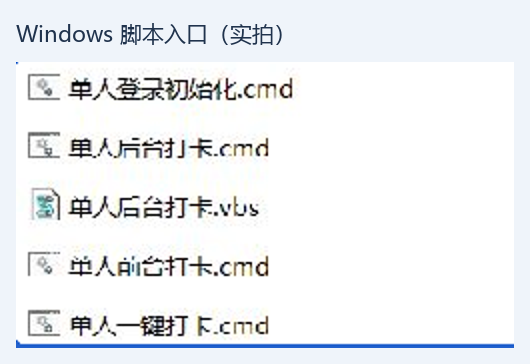
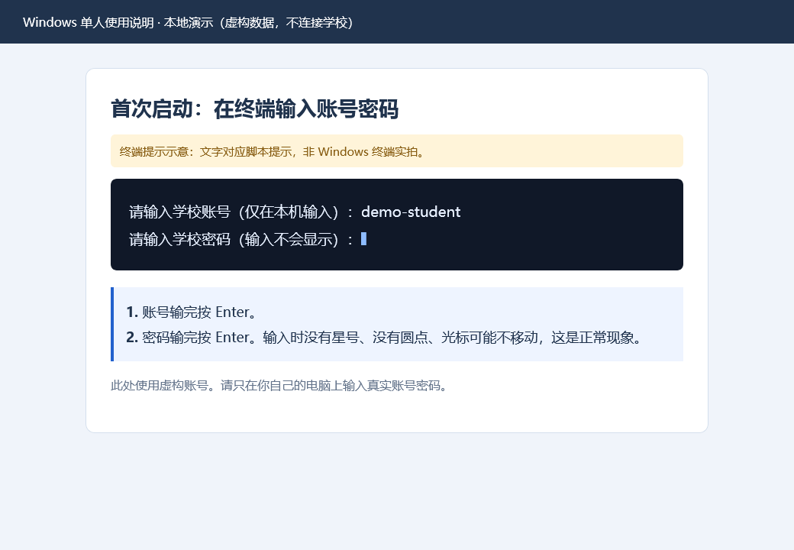
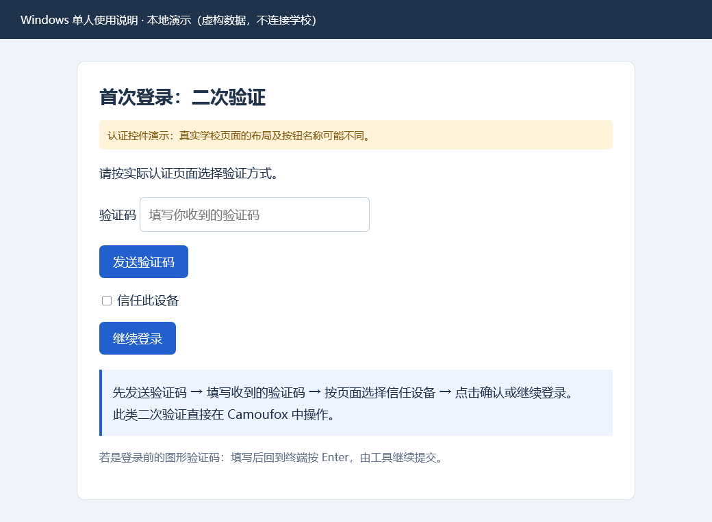
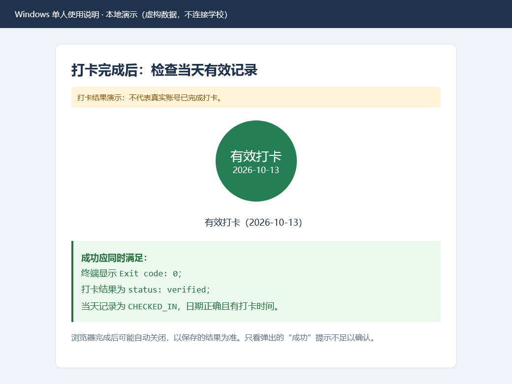
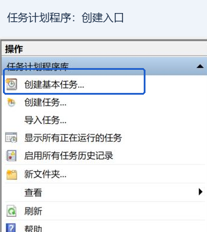
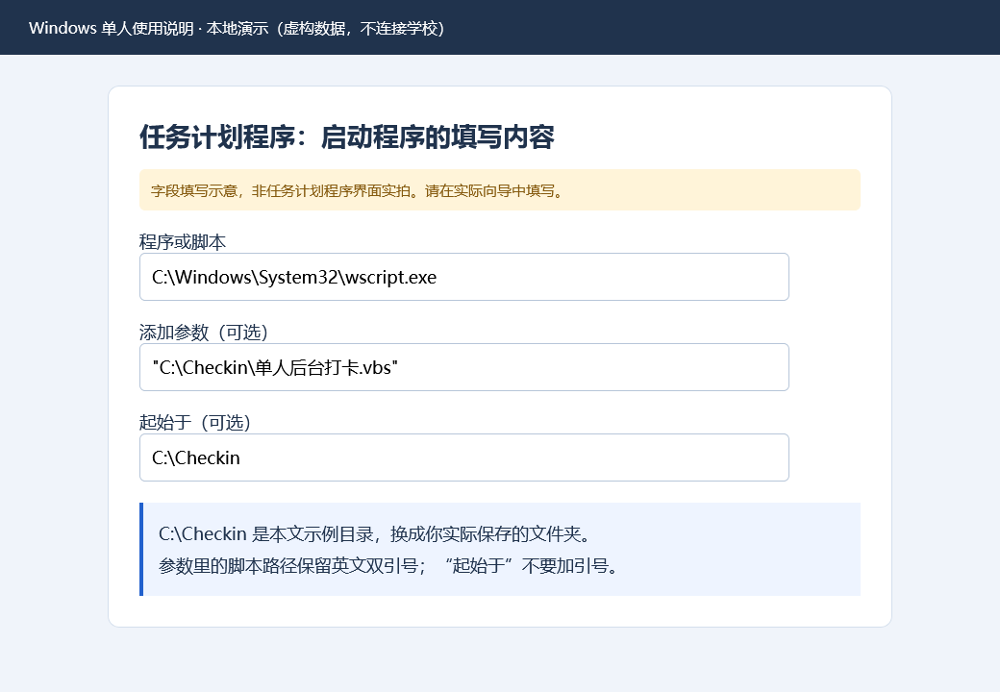

# Windows 单人使用说明（新手图文版）

适用于在自己的 Windows 电脑上使用一个学校账号的人。无需安装 Docker，也无需自己编程。首次配置后，可双击脚本打卡，也可让 Windows 每天定时运行。

**推荐顺序：准备文件 → 安装 uv → 首次登录验证 → 前台打卡确认 → 按需设置后台定时。** 首次登录可以白天完成；打卡须在学校允许的时段内进行，当前页面显示每天 21:00–23:30，以实际学校页面为准。

本文用 `C:\Checkin` 作示例目录，请换成自己的文件夹。文件列表、任务计划程序入口是裁剪后的 Windows 实拍；其余图片是虚构数据制作的本地演示，图上均有标记，不代表真实账号状态。真实学校页面的布局可能不同。图片不包含真实账号、验证码或位置。

## 目录

1. [准备文件与电脑](#prepare)
2. [安装 uv](#install)
3. [首次登录与二次验证](#first-login)
4. [日常前台打卡与成功判断](#daily)
5. [后台无窗口运行](#background)
6. [设置每天自动运行](#schedule)
7. [常见问题](#faq)
8. [修改密码、选择区域与备份](#maintenance)

<a id="prepare"></a>
## 1. 准备文件与电脑

使用 Windows 10/11 的 64 位电脑，连接能访问学校平台的网络。首次需要下载运行环境和浏览器，比日常运行耗时更长。

1. 将收到的**完整项目压缩包**保存到电脑，右键点击，选择“全部解压缩”。不要在压缩包内运行脚本。
2. 将解压后的项目放在固定位置，例如 `C:\Checkin`。目录内应有 `auto_location` 文件夹、`main.py`、`pyproject.toml`、`uv.lock` 和下面的中文脚本。不要只复制几个脚本。
3. 打开项目文件夹，直到找到“单人登录初始化.cmd”；压缩包解压后可能还有一层同名文件夹。
4. 看不到 `.cmd`、`.vbs` 后缀时：Windows 11 在“查看 → 显示”中勾选“文件扩展名”；Windows 10 在“查看”中勾选“文件扩展名”。



图 1：只关注以“单人”开头的文件。图片仅保留脚本名称，无用户信息。

| 文件 | 什么时候使用 | 能看到什么 |
| --- | --- | --- |
| **单人登录初始化.cmd** | 第一次使用；重新检查登录 | 终端和 Camoufox；只登录、不打卡 |
| **单人前台打卡.cmd** | 推荐的日常入口；处理验证码 | 终端和浏览器，可观察过程 |
| **单人后台打卡.vbs** | 初始化后静默运行、定时任务 | 不显示终端和浏览器，通过结果文件确认 |
| 单人后台打卡.cmd | 后台脚本；VBS 不可用时使用 | 可能短暂出现终端；浏览器不显示 |
| 单人一键打卡.cmd | 通用入口 | 默认前台；首次会引导登录后尝试打卡 |

<a id="install"></a>
## 2. 安装 uv（通常只需一次）

`uv` 帮助脚本准备 Python 和所需组件。**无需自己安装 Python 或 Camoufox**，脚本会负责准备。

1. 点击 Windows“开始”，搜索 **PowerShell**，打开“Windows PowerShell”或“PowerShell”。通常无需以管理员身份运行。
2. 复制下面一行，粘贴到窗口中，按 **Enter（回车）**。不要复制代码框外的文字。

```powershell
winget install --id astral-sh.uv -e
```

3. 等待安装结束。如果安装程序要求确认软件源协议，阅读后按提示操作。安装方法来自 [uv 官方说明](https://docs.astral.sh/uv/getting-started/installation/)。
4. **关闭窗口，再打开一个新的 PowerShell**，输入下面一行，按 Enter。

```powershell
uv --version
```

5. 显示类似 `uv 0.x.x` 的版本号即安装成功，可以关闭窗口。版本号只是示例。

若找不到 `winget`，查看第 7 节；若安装后仍找不到 `uv`，先退出并重新登录 Windows，或重启后再试。不要在网页或聊天中填写学校密码。

<a id="first-login"></a>
## 3. 首次登录与二次验证

### 3.1 启动初始化

1. 回到项目目录，**双击“单人登录初始化.cmd”**。
2. 出现带文字的窗口，这是“终端”。首次可能下载 Python、依赖和 Camoufox；看到下载进度请等待，不要重复双击。
3. 看到“请输入学校账号”时，输入学校统一身份认证账号，按 Enter。
4. 看到“请输入学校密码”时，输入密码，再按 Enter。**输入时没有字符、没有星号，光标也可能不移动，这是正常现象。** 输错时可在按 Enter 前用退格修改；不要为了测试而重复输入几遍。



图 2：终端提示示意。账号为虚构数据；密码不会显示出来。

工具在本机加密保存凭据，以后自动登录不必每次输入。单人流程不使用浏览器原生密码管理器保存密码。

### 3.2 在 Camoufox 中完成验证

随后自动打开 **Camoufox** 浏览器，进入学校平台并自动填写账号密码。保持终端和浏览器打开。

| 遇到的页面 | 应当怎么操作 |
| --- | --- |
| 无额外验证 | 等待进入“晚安成电”即可 |
| **提交账号密码前的图形验证码** | 在 Camoufox 填写，暂不点击登录；切回终端，看到“填写后在这里按回车继续”时按 Enter |
| **提交后的短信、邮箱等二次验证** | 在 Camoufox 按页面发送、填写验证码，点击实际页面的“确认”“继续登录”等按钮；通常不需在终端回车 |
| “信任此设备”或类似选项 | 在自己的可信电脑上按页面完成设备信任，便于后续复用登录状态 |



图 3：本地演示页面，展示关键控件。使用实际收到的验证码；不要使用任何示例内容。

**填了验证码却没继续？** 先区分上表两种验证：图形验证码可能需要回到终端按 Enter；短信等二次验证需要在浏览器点击验证提交按钮。不要重复启动脚本或反复提交密码。首次验证最多等待约 10 分钟；超时后查看错误，确认旧浏览器关闭，再重新初始化。

### 3.3 确认初始化成功

工具进入“晚安成电”确认会话并保存登录状态，浏览器随后可能自动关闭。终端应显示：

```text
登录已确认。下次运行一键脚本可自动打卡。
Exit code: 0. Results: .state\single-user\login-result.json
```

看到 `Exit code: 0` 后可按任意键关闭终端。**初始化成功只代表登录准备完成，不代表当天已打卡。** 初始化可白天进行，不提交打卡。非零退出码表示失败，请处理错误后再设置后台定时。

<a id="daily"></a>
## 4. 日常前台打卡与成功判断

至少先确认一次前台打卡成功，再使用后台模式。

1. 在学校允许的打卡时段内，确保电脑联网。
2. 双击 **“单人前台打卡.cmd”**。无需先手动登录其他浏览器。
3. 工具复用登录状态或自动填写保存的凭据，确认登录后读取允许区域，选择范围内的随机坐标，提交并刷新核验。
4. 如需再次验证，在 Camoufox 按第 3 节处理；保持终端开启。
5. 等待结束，确认终端显示 **`Exit code: 0`**，再检查当天打卡结果。运行中不要重复双击。



图 4：结果演示，不表示真实账号已打卡。成功依据是刷新后的当天有效记录。

### 打开结果文件

1. 在项目文件夹地址栏中输入 `C:\Checkin\.state\single-user`，按 Enter；替换成实际目录。
2. 右键 `run-result.json`，选择“打开方式 → 记事本”。检查 `finished_at` 是本次时间、`exit_code` 为 `0`、`status` 为 `success`。
3. 同样打开 `checkin-result.json`。应看到 `status` 为 `verified`、`recordStatusCode` 为 `CHECKED_IN`、`businessDate` 为当天日期，且 `checkinTime` 有值。
4. 不要编辑这些文件；可在记事本开启“自动换行”方便阅读。

**注意：** 只运行初始化时，运行摘要也可以成功，要看 `login_only` 是否为 `true`；登录成功不能替代打卡成功。旧的 `checkin-result.json` 不能证明本次成功，须核对日期、时间和本次报错。浏览器可能自动关闭，以保存的核验结果为准，不能只看弹出的成功提示。

已打卡时工具只核验，避免重复提交。失败或结果未知时，先查明状态再操作，不要连续重试。

<a id="background"></a>
## 5. 后台无窗口运行

完成初始化并确认前台流程可用后，在打卡时段双击 **“单人后台打卡.vbs”**。

**没有出现任何窗口是正常现象。** 入口隐藏终端，浏览器也在后台运行；它不是常驻服务，双击只执行一次，不会自己每天启动。不要因看不到窗口而重复双击。

等待完成后，按第 4 节检查本次结果。详情在 `.state\single-user\background.log`，用记事本打开，滚动到末尾查看最新日志。运行中结果文件可能仍是上次内容。

后台不会弹出验证码、询问密码或切换前台；需要重新验证、缺少密钥等情况会失败退出。请在前台处理后再恢复后台使用。

<a id="schedule"></a>
## 6. 设置每天自动运行（可选）

Windows 单人版使用“任务计划程序”。下面设置**每天 21:05 启动一次**，时间可按学校允许时段调整。此处为固定时间；Docker 的“时间段内随机启动”是另一套功能。

### 6.1 创建基本任务

1. 点击“开始”，搜索 **任务计划程序**，打开。
2. 左侧点击“任务计划程序库”，右侧点击 **“创建基本任务…”**。



图 5：只保留创建入口，不展示本机已有任务或用户信息。

3. 名称填写“晚安成电单人打卡”，点击“下一步”。
4. 选择“每天”，点击“下一步”。
5. 开始日期选今天或希望开始的日期，时间填写 **21:05:00**，“每隔”填写 **1** 天。确认 Windows 的日期、时间和时区正确。
6. 操作选“启动程序”，点击“下一步”。

### 6.2 填写三个输入框

三项分别填入对应输入框，不要合并为一行。

| 输入框 | 示例内容 |
| --- | --- |
| 程序或脚本 | `C:\Windows\System32\wscript.exe` |
| 添加参数（可选） | `"C:\Checkin\单人后台打卡.vbs"` |
| 起始于（可选） | `C:\Checkin` |



图 6：项目在其他目录时修改后两项。参数保留英文双引号，“起始于”不加引号。

点击“下一步”检查内容，勾选“当单击完成时，打开此任务属性的对话框”，再点击“完成”。

### 6.3 检查属性

1. **常规：** 使用首次初始化的同一个 Windows 用户。新手先选择“只在用户登录时运行”，不勾选“使用最高权限运行”。这里指 Windows 用户，不是学校账号。
2. **条件：** 检查“只有在计算机使用交流电源时才启动”。若需电池供电时执行，按实际需求调整。打卡时电脑要开机、联网、未休眠。
3. **设置：** 已经运行时选择 **“不启动新实例”**；可设最长运行 20 分钟，避免异常任务一直占用。
4. 不设置重复触发或失败自动重启。建议关闭“如果过了计划开始时间，立即启动任务”，避免第二天开机补跑到时段之外。
5. 点击“确定”保存。

选择“只在用户登录时运行”后，要保持该用户登录。锁屏与休眠不同；睡眠、关机或退出用户后不能指望任务照常执行。可先保持插电、开机、登录和联网来验证。退出登录后仍执行的进阶设置由熟悉任务计划程序的用户处理；不要改用 `SYSTEM` 或其他用户来绕过单人目录权限。

### 6.4 测试、改时间与停用

1. **在允许打卡时段内**找到该任务，右键“运行”，实际执行一次打卡。
2. 完成后刷新列表，查看“上次运行结果”。**`0x0` 表示脚本成功退出**；仍需核对本次摘要和当天打卡记录。
3. 没有浏览器窗口属于正常后台行为；非 `0x0` 时先查看 `background.log`。
4. 调整时间：右键“属性 → 触发器 → 编辑”。停止每天运行：右键“禁用”；之后可“启用”恢复。禁用不终止正在执行的任务。

移动项目目录后，同时修改“操作”中的脚本参数和起始目录；只改桌面快捷方式不会更新定时任务。

<a id="faq"></a>
## 7. 常见问题

| 现象 | 原因或下一步 |
| --- | --- |
| 密码输入无字符 | 正常隐藏输入；输完回车，不要重复输入 |
| `uv is required`、找不到 uv | 按第 2 节安装；重新打开窗口，必要时重新登录 Windows |
| 找不到 winget | 应用安装程序不可用；按 [uv 官方说明](https://docs.astral.sh/uv/getting-started/installation/)选择安装方式，或请熟悉电脑的人协助 |
| 首次卡在下载 | 看到进度请等待；明确失败时检查网络或请维护者处理下载代理 |
| 验证码填了无反应 | 区分图形验证码与二次验证，见第 3 节 |
| 后台模式尚未初始化 | 先完成初始化，确认退出码为 0 |
| 后台双击没窗口 | 预期行为，检查本次结果文件时间与日志 |
| 再次要求验证、设备信任过期 | 前台模式或初始化中完成验证，后台不会等待 |
| 非打卡时段、范围未确认、无区域 | 按错误信息检查；登录成功不等于打卡成功 |
| 多个允许区域 | 按第 8 节确认正确序号，不要盲目填 0 |
| 提示任务已运行、存在锁 | 等待当前任务；异常中断后按下方说明处理 |
| VBS 或 Windows Script Host 不可用 | 使用后台 CMD；定时任务备用写法见第 8 节 |
| 定时任务没启动 | 检查启用状态、用户登录、休眠、网络、电源条件和路径 |
| 非零退出、结果未知 | 查看本次日志和学校当天记录，避免盲目重复提交 |
| 旧结果成功、本次失败 | 核对日期与 `finished_at`，旧文件不代表本次成功 |
| 密钥丢失、不能解密 | 恢复原密钥和对应数据；不要生成新密钥覆盖旧文件 |

异常中断且确认本工具的进程与浏览器均已结束后，若仍提示锁占用，在 `.state\single-user` 中仅删除 **`one-click.lock`**，再启动。运行中不能删锁，也不要删除整个数据目录。

向他人求助时描述错误文字即可；分享截图或日志前遮盖学号、姓名、验证码、宿舍名称和经纬度。不要发送完整 `.state`、`.secrets`、浏览器数据或密钥。结果文件可能含位置，不能直接公开。

<a id="maintenance"></a>
## 8. 修改密码、选择区域与备份

以下为可选维护操作。先在 PowerShell 输入 `cd C:\Checkin` 并回车，进入实际目录，再执行对应命令。路径有空格时使用 `cd "你的完整目录"`。

### 学校密码变更

```powershell
.\单人登录初始化.cmd --setup
```

重新询问账号密码并引导验证，只登录、不打卡。普通双击初始化会复用已保存凭据，不会每次重新询问。单人目录建议只用于同一个学校账号。

### 多个允许区域时

先读取区域列表，不提交打卡；遇到验证时先用 GUI 初始化，再执行。

```powershell
uv run python main.py discover --accounts .state/single-user/accounts.json --account-id single-user --auto-login --headless --output .state/single-user/allowed-areas.json
```

记事本打开 `allowed-areas.json`，按名称确认应使用的条目及 `index`。序号从 0 开始；列表不符合实际时联系维护者，不要猜测。比如确认正确序号为 0 后，执行下列只登录命令保存选择，以后无需重复指定：

```powershell
.\单人登录初始化.cmd --area-index 0
```

学校区域配置变更后应重新核对。

### Windows Script Host 不可用时的定时入口

| 输入框 | 内容 |
| --- | --- |
| 程序或脚本 | `C:\Windows\System32\cmd.exe` |
| 添加参数 | `/d /c ""C:\Checkin\单人后台打卡.cmd""` |
| 起始于 | `C:\Checkin` |

此备用方式可能短暂显示终端，浏览器仍不显示；同样使用初始化的 Windows 用户。

### 备份、搬目录和换电脑

`.state\single-user` 保存配置、会话、结果及加密凭据；`.secrets\single-user\vault.key` 是解密密钥。**备份须同时保留两个目录，并妥善保管；不要把包含它们的项目目录发送给他人。** 单人数据与 Docker 多用户网页数据独立。

目录权限限制给初始化时的 Windows 用户。本机移动目录时保留数据和密钥，并更新定时路径。换用户、换电脑时，新手建议重新初始化、保存凭据和验证设备，不直接拷贝旧虚拟环境。

凭据使用 AES-256-GCM 加密保存，不提供密码管理器查看入口；本机管理员、当前用户或可调试进程的人仍可能接触运行中的明文。不要在不可信电脑上配置。

区域内随机坐标属于模拟位置，不是设备实时定位，也不证明人在宿舍。成功以学校刷新后的当天有效记录为准。
